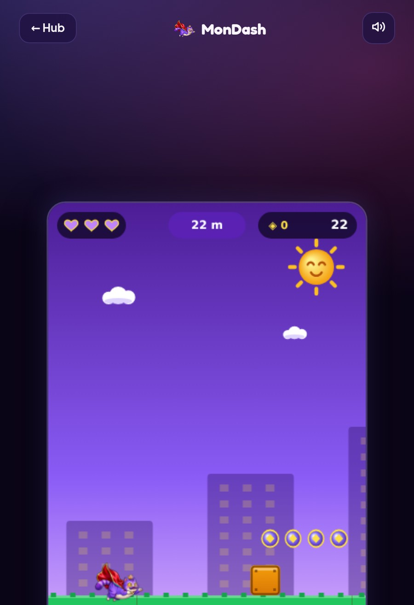
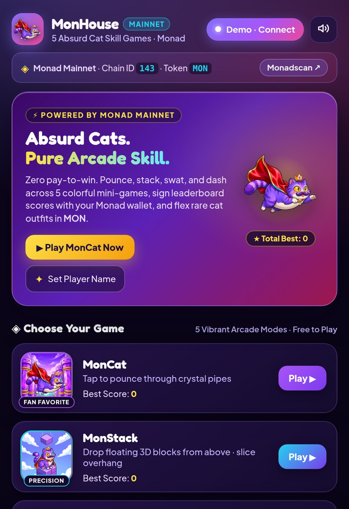
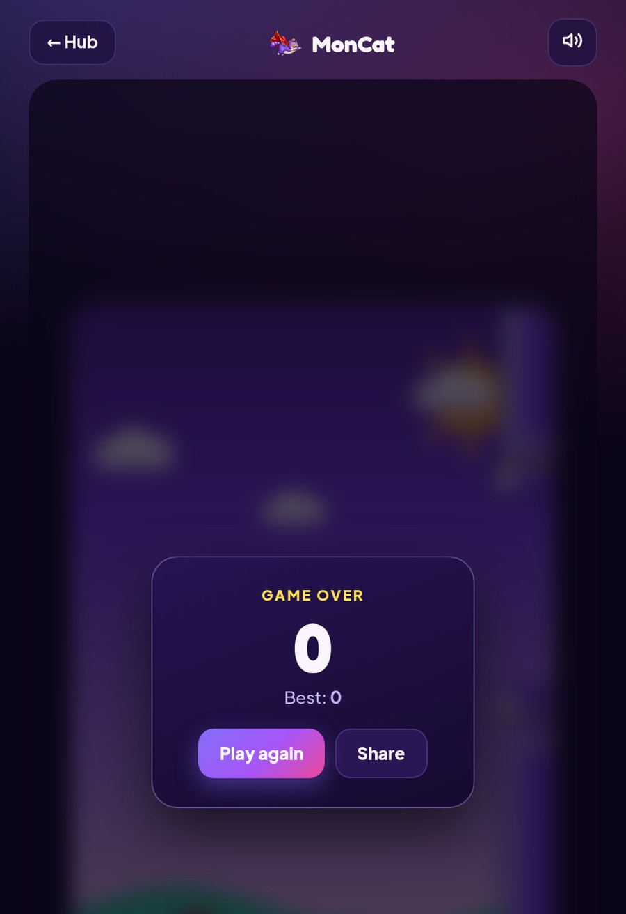
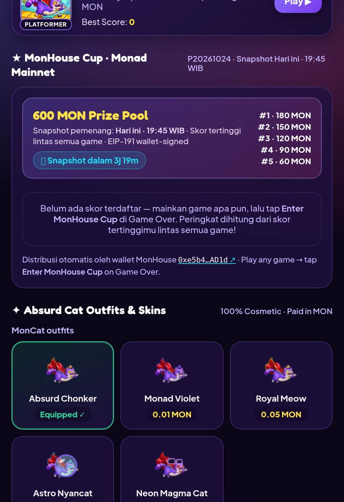
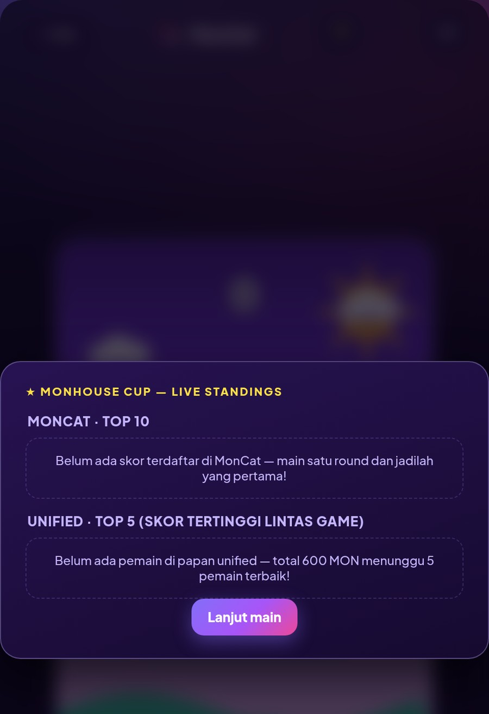

<div align="center">



# 🐱👑 MonHouse

**The absurd cat arcade on Monad — skill-only, free-to-play, prizes paid on-chain.**

[](https://monhouse.fun)
[](https://monadscan.com)
[](https://monad.xyz)
[](#testing)
[](LICENSE)
[](CONTRIBUTING)

*MonHouse* · *MonCat* · *MonStack* · *MonRush* · *MonSwat* · *MonDash*

</div>

---

## 📖 About

**MonHouse** is a colorful, mobile-first arcade hub featuring **5 skill-based mini-games** starring
**King Nads Meow** — a chonky purple tabby with a golden crown, a hero cape, heterochromia eyes
and zero thoughts. Every high score is **signed with the player's EVM wallet (EIP-191)**, ranked
on a public leaderboard, and tournament prizes are **distributed automatically on-chain** by the
MonHouse house wallet.

No downloads. No NFTs to buy. No pay-to-win. Open the site, play, sign, win.

| | |
|---|---|
| 🌐 **Live** | [monhouse.fun](https://monhouse.fun) (Vercel edge, auto-SSL) |
| ⚡ **Network** | Monad Mainnet — Chain ID `143` (`0x8f`), native token `MON` |
| 🔍 **Explorer** | [monadscan.com](https://monadscan.com) · [monadvision.com](https://monadvision.com) |
| 🛠 **Stack** | React 18 · Vite 5 · Canvas 2D · Serverless API · `@noble/curves` + `js-sha3` |
| 🧪 **Quality** | 21-assertion pre-push smoke suite (`npm test`) |
| 📄 **License** | MIT (this repo) — forked from the open-source [NimHouse](https://github.com/sasam44/nimhouse) |

### Why it's different

| Common web3 game problem | MonHouse answer |
|---|---|
| Heavy onboarding (buy NFT first) | Play instantly in the browser — wallet only needed to *claim* a prize entry |
| Fakeable leaderboards | Every score is **EIP-191 wallet-signed** and verified server-side |
| Opaque prize payouts | Prizes are sent **on-chain by the house wallet**; every tx links to Monadscan |
| Pay-to-win economies | **Cosmetics only** — skins and cheers never affect gameplay |

---

## 🎮 The Games

| Game | Genre | One-liner |
|---|---|---|
| 🐱 **MonCat** | Flappy-style | Tap / `Space` to pounce through glossy crystal Monad pipes |
| 🧱 **MonStack** | Timing / precision | Drop hovering blocks onto the tower — perfect stacks build combos |
| 🏃 **MonRush** | 3-lane runner | Weave past cows, UFOs, rival cats and giant sausages |
| 🪰 **MonSwat** | Reflex | Bonk the smug sunglasses fly before 5 misses let it escape |
| 🏃‍♂️ **MonDash** | Side-scrolling platformer | Mario-style blocks & pits — stomp flies, grab spinning `MON` coins |

<div align="center">
  
</div>

---

## 🏆 MonHouse Cup

The MonHouse Cup is a **snapshot tournament**: play any game during the window, tap
**★ Enter MonHouse Cup** on Game Over to sign your score, and at the snapshot moment
(`pool.closeAt` in [`data/cup.json`](data/cup.json)) the board freezes and prizes flow
automatically from the house wallet.

| Rule | Value |
|---|---|
| **Ranking basis** | Each player's **highest score across ALL games** (one unified board) |
| **Prize pool (current cup)** | **600 MON** |
| **Prize tiers** | 🥇 180 · 🥈 150 · 🥉 120 · #4 90 · #5 60 MON |
| **Distribution** | Automatic, on-chain, from the MonHouse house wallet |
| **Integrity** | EIP-191 `personal_sign` per entry · one entry per wallet · submissions rejected after snapshot |

<div align="center">
 
</div>

> The current cup window, tiers and pool are configuration, not code — edit `pool` in
> `data/cup.json` (`closeAt`, `tiersMon`, `totalMon`) to schedule the next one. Period IDs
> (`P<YYYYMMDD>` in Asia/Jakarta time) are derived automatically from `closeAt`.

### Running the payout

```bash
node scripts/payout.mjs --dry-run        # preview winners & prizes
node scripts/payout.mjs --auto           # auto-send 180/150/120/90/60 MON from the house wallet
```

`--auto` signs native EIP-155 transfers (Chain ID 143) with the house key
(`MONHOUSE_PAYOUT_KEY` env) and records every tx hash back onto the public board
 via `/api/cup/payout` (requires `CUP_ADMIN_SECRET`), so winners see a
verifyable **paid ✓** link to Monadscan.

---

## 🚀 Quick Start

```bash
git clone https://github.com/Mon-House/MonHouseApp.git
cd MonHouseApp
npm install
npm run dev        # http://localhost:5173
```

```bash
npm run build      # production build -> dist/
npm test           # 21-assertion smoke suite (build + crypto + API E2E)
```

### Configuration

Copy `.env.example` → `.env` (or set them in Vercel):

```env
VITE_HOUSE_ADDRESS=0xe5b41b1e42580ddb14F277578D5f92Fc091DAD1d
VITE_CHEER_ADDRESS=0xe5b41b1e42580ddb14F277578D5f92Fc091DAD1d
VITE_MONAD_RPC=https://rpc.monad.xyz
```

| Variable | Purpose |
|---|---|
| `VITE_HOUSE_ADDRESS` | Wallet receiving skin purchases (cosmetics) |
| `VITE_CHEER_ADDRESS` | Wallet receiving cheer tips |
| `CUP_ADMIN_SECRET` | Admin secret to record payout tx hashes |
| `CUP_GITHUB_TOKEN` / `CUP_GITHUB_REPO` | **Recommended in production** — persists the Cup ledger to `data/*.json` in your GitHub repo (auditable, survives redeploys) |
| `MONHOUSE_PAYOUT_KEY` | House wallet private key — **only** for running `payout.mjs --auto` locally. Never deploy this anywhere. |

---

## 🗂 Project Structure

```
├── api/                  # Serverless API (Vercel functions)
│   ├── cup.js            #   GET  /api/cup        — live standings + pool
│   ├── cup/submit.js     #   POST /api/cup/submit — wallet-signed score entry
│   ├── cup/payout.js     #   POST /api/cup/payout — record payout tx (admin)
│   ├── cheer.js          #   GET/POST /api/cheer  — MON tip board
│   └── name/claim.js     #   POST /api/name/claim — player name claiming
├── data/                 # Public JSON ledger (cup entries, names, cheers)
├── docs/
│   ├── MONAD_DEPLOY.md   # Deployment guide (GitHub + Vercel, Bahasa Indonesia)
│   └── screenshots/      # Screenshots used in this README
├── scripts/payout.mjs    # Cup payout runner (dry-run / interactive / --auto)
├── src/
│   ├── games/            # MonCat · MonStack · MonRush · MonSwat · MonDash
│   ├── components/       # ScoreOverlay (game-over + cup entry + standings)
│   ├── wallet.js         # Monad mainnet wallet adapter (EIP-1193 + demo mode)
│   ├── sketch.js         # Shared canvas renderers (cat, blocks, fly, pipes…)
│   └── skins.js          # Cosmetic-only skin catalog
├── test/smoke.mjs        # Pre-push verification suite
└── vercel.json           # Serverless config (data/** bundled with functions)
```

---

## 🔐 Security & Fairness

- **Scores are signatures.** A cup entry only counts if `personal_sign` recovers to the claimed
  address (secp256k1 + keccak256, verified server-side in `api/lib/verify.js`).
- **One entry per wallet** per game per period — enforced on write, identity-bound.
- **Bound scores** — server rejects scores outside `0 … 1,000,000` and messages that don't
  match the signed payload (`score=`, `game=`, `period=`).
- **Snapshot discipline** — after `closeAt` the API refuses new entries and the board freezes.
- **Cosmetics can't win** — skins are visual only; a hard rule enforced by the game engine.
- **Transparent ledger** — entries and payouts live in `data/*.json` (optionally committed to
  GitHub by the API itself) and every prize links to an on-chain transaction.

---

## 🧪 Testing

```bash
npm test
```

The smoke suite covers, end-to-end:

1. **Production bundle** — title, wallet address, Chain ID 143, zero legacy/testnet strings
2. **Cryptography** — real EIP-191 signature recovery, tamper rejection
3. **API handlers** — cup state, name claim, score submit (incl. closed-cup rejection and
   cross-game score merging), cheer duplicate-tx rejection

---

## 🛠 Deployment (Vercel)

The app is a standard Vite SPA + serverless functions — zero-config on Vercel:

1. Import the repo on [vercel.com](https://vercel.com) (framework preset: **Vite**)
2. Set the environment variables from [Configuration](#configuration)
3. Deploy — done. Point your domain's DNS at Vercel and SSL is automatic.

Full walkthrough (Bahasa Indonesia): [`docs/MONAD_DEPLOY.md`](docs/MONAD_DEPLOY.md)

---

## 🗺 Roadmap

- [x] 5 mini-games, wallet-signed leaderboards, Cup v3 snapshot tournaments
- [x] Automated on-chain prize distribution
- [x] Official domain — monhouse.fun
- [ ] Recurring seasonal cups with bigger pools & sponsor splits
- [ ] 6th game + new King Nads Meow cosmetics
- [ ] Telegram / mini-app distribution

---

## 🙏 Acknowledgements

- **[NimHouse](https://github.com/sasam44/nimhouse)** — the original open-source Nimiq arcade this project was migrated and rebranded from. 🐾
- **[Monad Labs](https://www.monad.xyz)** — for a chain where 0.6s finality makes on-chain arcade payouts feel instant.

## ⚠️ Disclaimer

MonHouse is a skill arcade running on a public blockchain. `MON` is a real, tradable asset —
prizes, skins and cheers move real value. Nothing here is financial advice; play because it's
fun, not for yield.

## 📄 License

[MIT](LICENSE) © 2026 MonHouse Team

<div align="center">

**🐱👑 [monhouse.fun](https://monhouse.fun) — main satu game, sisanya biarkan King Nads Meow yang bicara. ⚡**

</div>
